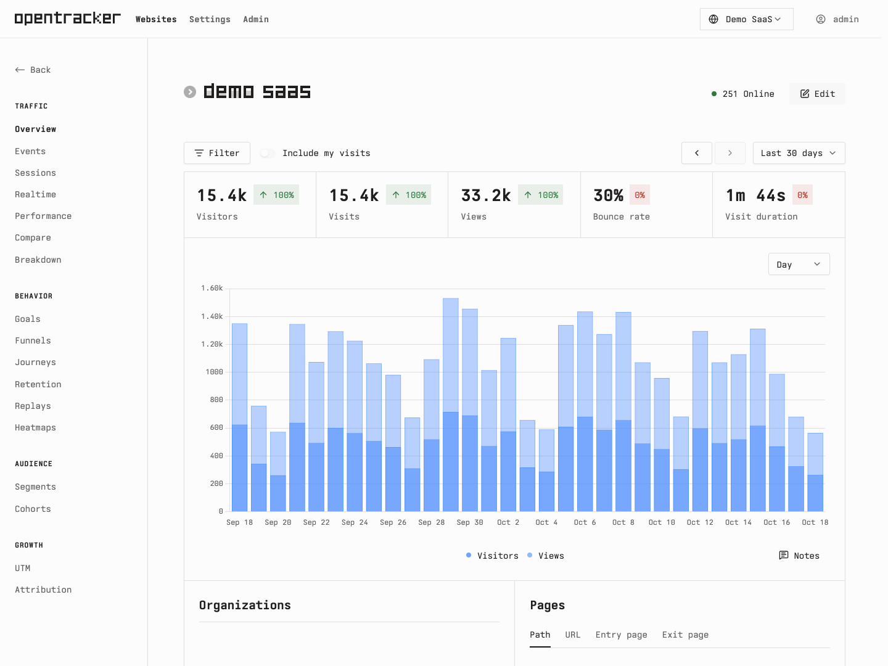
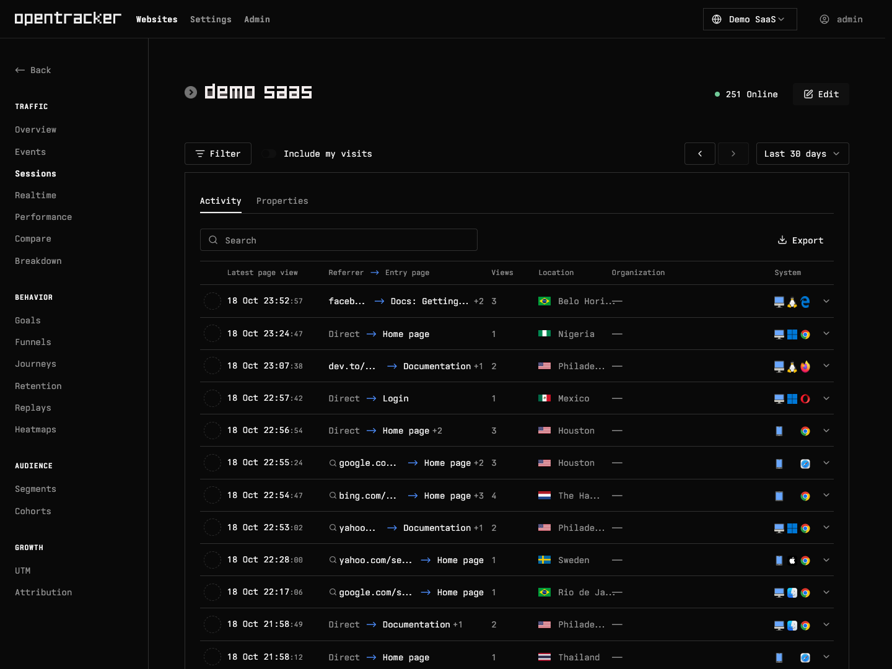

# OpenTracker

[](https://github.com/Friedrich-M/opentracker/actions/workflows/ci.yml) [](LICENSE)

Self-hosted web analytics with visitor activity, session replay and heatmaps. See how people find and use your website, with the dashboard and its data on infrastructure you control.

A Next.js, React and TypeScript application on PostgreSQL, with an English and Simplified Chinese dashboard in light and dark themes that works on a phone.



_Screenshots come from a local demo database with generated data. No production analytics or visitor records are included._

[Quick start](#quick-start) · [Track a website](#track-a-website) · [Configuration](#configuration) · [Deploy](#deploy) · [Architecture](docs/architecture.md) · [Contributing](CONTRIBUTING.md)

## Features

| Feature                   | What you get                                                                                                                                                                      |
| ------------------------- | --------------------------------------------------------------------------------------------------------------------------------------------------------------------------------- |
| Traffic overview          | Visitors, visits, page views, bounce rate and visit duration over any period, with comparisons and breakdowns by page, referrer, location, browser and device.                    |
| Visitor activity          | One line per session: where the visitor came from, where they landed, what they read, their place and organisation. Expand it for the full record and a visitor panel with a map. |
| Projects within a website | Tag pages (`data-tag="docs"`) and read every report for one project or the whole domain. A visitor crossing projects stays one session.                                           |
| Events and conversions    | Custom events, automatic outbound-link and download events, goals, funnels and journeys.                                                                                          |
| Audience and acquisition  | Retention, segments, cohorts, UTM campaigns and attribution.                                                                                                                      |
| Session replay            | Sampled recordings with per-project playback, saved recordings that never expire, and automatic cleanup of the rest.                                                              |
| Heatmaps                  | Click and scroll maps per page once the recorder is enabled for the website.                                                                                                      |
| Sharing                   | Read-only share links scoped to one website and the sections you choose. Visitor network details never leave the owner's view.                                                    |
| Access control            | Website ownership, an administrator role, API keys and two-factor authentication.                                                                                                 |

### Visitor activity in dark mode



## How it differs from Umami

- **Projects by page tag.** Each domain is one website; sections of it are tags on the tracking script, selectable as tabs on every report. Replay chunks remember their page's tag, so a project view plays only its own pages.
- **Visitor-centred session list.** Sessions are listed by referrer, entry page and organisation, with a visitor panel showing the approximate location on a map, the network and the navigation paths across all of your websites. Visitor labels let you name a returning address.
- **Network data stays with the owner.** IP addresses, autonomous systems and organisations are shown to signed-in users only; share links receive sessions without them and cannot search by them.
- **Your own visits are hidden.** A browser marked from the dashboard, or any local preview, is recorded as internal and left out of reports unless you ask for it.
- **Replay storage you can move.** Replay bodies live in PostgreSQL by default, or in Cloudflare R2 behind a small Worker, with a retention job for unsaved recordings.
- **A documentation-style dashboard.** The interface adapts [opencode](https://github.com/anomalyco/opencode)'s design, follows the system theme and ships a complete Simplified Chinese translation.
- **Less surface.** Teams, boards, links, pixels and revenue reports from upstream are removed, as is the public visit counter.

## How it works

```
page on example.com
  script.js    ── POST /api/send   ──▶ session + website_event        ─┐
  recorder.js  ── POST /api/record ──▶ session_replay, heatmap_event   ├─▶ PostgreSQL ──▶ dashboard and API
                                        (bodies optionally in R2)      ─┘
```

A visit needs no cookie: the session id is a hash of the website, the visitor's address, the user agent and a rotating salt. Location comes from the hosting platform's headers or the bundled GeoLite2 databases, and the organisation from GeoLite2-ASN. [docs/architecture.md](docs/architecture.md) follows a visit from the script to the dashboard, including the permission boundaries.

## Requirements

- Node.js as pinned in [.node-version](.node-version) and the pnpm version pinned in [package.json](package.json) (`npx --yes pnpm@12.3.4` works without a global install).
- PostgreSQL 14 or newer; CI runs against PostgreSQL 17. Local development can use the bundled embedded server instead.
- Outbound network access during the build, for the GeoLite2 download.

## Quick start

Clone into a normal local directory, outside cloud-synced folders such as iCloud Drive, and install the locked dependencies:

```sh
git clone https://github.com/Friedrich-M/opentracker.git
cd opentracker
pnpm install --frozen-lockfile
```

Create a local environment file with fresh secrets (the command refuses to overwrite an existing `.env`), then start the embedded PostgreSQL and leave it running:

```sh
node --input-type=module <<'JS'
import { readFileSync, writeFileSync } from 'node:fs';
import { randomBytes } from 'node:crypto';
const template = readFileSync('.env.example', 'utf8');
const env = template.replace(/^(APP_SECRET|TWO_FACTOR_ENCRYPTION_KEY)=$/gm,
  (_, key) => `${key}=${randomBytes(32).toString('hex')}`);
writeFileSync('.env', env, { flag: 'wx', mode: 0o600 });
JS
pnpm db:local
```

In a second terminal in the same checkout, apply the migrations, seed demo data and start the dev server:

```sh
pnpm build:db && pnpm check:db
pnpm db:seed
pnpm build:tracker && pnpm build:recorder && pnpm build:geo
pnpm dev
```

Open `http://localhost:3000` and sign in as `admin` with the password `umami`. **Change it before exposing any deployment**; new passwords need at least 8 characters. `db:seed` creates two fictitious websites with visits; run it only against a disposable database. The [development guide](docs/development.md) covers checks, screenshots and troubleshooting.

## Track a website

Add a website in the dashboard and copy its tracking code. For an instance at `https://analytics.example.com`:

```html
<script defer src="https://analytics.example.com/script.js" data-website-id="YOUR_WEBSITE_ID" data-tag="docs"></script>
```

`data-tag` is optional and names the project the page belongs to. For replays and heatmaps, enable recording in the website's settings and add `recorder.js` with the same website ID and tag. [Website integration](docs/site-integration.md) covers sampling, hash routes, embedded pages and marking your own browser as internal.

## Configuration

[.env.example](.env.example) holds local development defaults. Keep production secrets in protected server or provider configuration, never in Git.

| Variable                                  | Required               | Purpose                                                                                                                                                                                                                                                                                                                      |
| ----------------------------------------- | ---------------------- | ---------------------------------------------------------------------------------------------------------------------------------------------------------------------------------------------------------------------------------------------------------------------------------------------------------------------------- |
| `DATABASE_URL`                            | Yes                    | PostgreSQL connection used by the application.                                                                                                                                                                                                                                                                               |
| `APP_SECRET`                              | Yes                    | Random secret for signing tokens and hashing visitor sessions (`openssl rand -hex 32`). A production build refuses to run without it. Changing it signs everyone out and starts every visitor as new.                                                                                                                        |
| `TWO_FACTOR_ENCRYPTION_KEY`               | For two-factor sign-in | 64 hex characters for encrypting two-factor secrets. Keep it stable; changing it invalidates enrolled authenticators.                                                                                                                                                                                                        |
| `CLIENT_IP_HEADER`                        | Recommended            | The one proxy header that carries the visitor's address, such as `x-real-ip` behind the Nginx template. On Vercel it defaults to `x-real-ip`; `wrangler.jsonc` sets `cf-connecting-ip` on Cloudflare Workers. Without it any known proxy header is read, location headers are ignored and sign-in attempts are limited per username only; that is safe only behind a header-stripping proxy. |
| `DIRECT_DATABASE_URL`                     | No                     | Direct connection for migrations when the application uses a pooled endpoint.                                                                                                                                                                                                                                                |
| `IGNORE_IP`                               | No                     | Comma-separated IP addresses or CIDR ranges to drop from collection.                                                                                                                                                                                                                                                         |
| `OWNER_MARK`, `OWNER_COOKIE_DOMAIN`       | No                     | Secret marker for your own browsers and the cookie domain shared between the dashboard and the tracked site.                                                                                                                                                                                                                 |
| `CRON_SECRET`                             | With the cleanup job   | Bearer secret for the replay-cleanup endpoint.                                                                                                                                                                                                                                                                               |
| `REPLAY_RETENTION_DAYS`                   | No                     | Days to keep unsaved replays; default `14`.                                                                                                                                                                                                                                                                                  |
| `REPLAY_STORE_URL`, `REPLAY_STORE_SECRET` | No                     | Replay Worker endpoint and bearer secret for Cloudflare R2; set both or neither.                                                                                                                                                                                                                                             |
| `BUILD_GEO`                               | On Vercel              | Set to `1` to download the GeoLite2 databases during Vercel builds.                                                                                                                                                                                                                                                          |
| `MAXMIND_LICENSE_KEY`                     | No                     | MaxMind download key; without it the build uses a public mirror.                                                                                                                                                                                                                                                             |

Advanced settings, all optional:

| Variable                                               | Purpose                                                                                                                           |
| ------------------------------------------------------ | --------------------------------------------------------------------------------------------------------------------------------- |
| `REPLAY_COUNTRIES`                                     | Comma-separated ISO country codes whose visitors may be recorded; default `US,CN,HK,SG`, `*` records every country.               |
| `REPLAY_MAX_CHUNKS_PER_VISIT`                          | Replay chunks stored per visit before the recorder is refused; default `600`.                                                     |
| `HEATMAP_RETENTION_DAYS`                               | Days to keep heatmap points; unset keeps them indefinitely. Applied by the cleanup job.                                           |
| `NEXT_PUBLIC_PROJECT_ORDER`                            | Comma-separated tags listed first in the Projects tabs, in that order, such as `home,research,hobbies`; read at build time.       |
| `DATABASE_REPLICA_URL`                                 | Read replica for report queries.                                                                                                  |
| `SALT_ROTATION`                                        | How often the session salt rotates: `month` (default), `week` or `day`. A shorter period counts returning visitors as new sooner. |
| `REMOVE_TRAILING_SLASH`                                | Set to strip a trailing slash from collected URLs.                                                                                |
| `DISABLE_BOT_CHECK`                                    | Set to record visits from user agents recognised as bots.                                                                         |
| `CORS_MAX_AGE`                                         | Seconds browsers cache the collection endpoints' CORS preflight; default `86400`.                                                 |
| `DEFAULT_LOCALE`                                       | Dashboard language before a user chooses one, such as `zh-CN`.                                                                    |
| `USE_UUIDV7`                                           | Set to generate time-ordered UUIDv7 identifiers.                                                                                  |
| `GEOLITE_DB_PATH`, `GEOLITE_ASN_DB_PATH`               | Paths to your own GeoLite2-City and GeoLite2-ASN databases.                                                                       |
| `GEO_DATABASE_URL`, `GEO_ASN_DATABASE_URL`             | Download URLs for the GeoLite2 databases at build time.                                                                           |
| `SKIP_BUILD_GEO`, `SKIP_DB_CHECK`, `SKIP_DB_MIGRATION` | Skip the GeoLite2 download, the database check or the migrations during `pnpm build`.                                             |
| `LOG_QUERY`                                            | Set to log every database query; for debugging only.                                                                              |

## Deploy

`pnpm build` generates the Prisma client and browser scripts, **applies database migrations**, downloads the GeoLite2 databases and builds the application; `pnpm start` serves it. Back up the database before a production build: an application rollback does not undo migrations. [Releases](https://github.com/Friedrich-M/opentracker/releases) list what each version changes.

**Migrating from Umami.** OpenTracker runs on an Umami database, but its migrations permanently delete what it removed: boards, links, pixels, teams (team websites pass to the team owner), revenue, their share links and their events. Back up first and try the migration on a copy.

- **Linux server.** The [server guide](docs/deployment.md#linux-server) walks through PostgreSQL, a protected environment file, an unprivileged systemd service, Nginx with HTTPS, the replay-cleanup timer, backups and upgrades, with templates in [deploy/](deploy/).
- **Vercel.** Import the repository as a project, add a PostgreSQL database, set `DATABASE_URL`, `APP_SECRET`, `TWO_FACTOR_ENCRYPTION_KEY`, `BUILD_GEO=1` and `CRON_SECRET`, then deploy; the checked-in cron runs the cleanup. See [the Vercel section](docs/deployment.md#vercel).
- **Cloudflare Workers.** Needs the Workers Paid plan. Store secrets with `npx wrangler secret put`, export `DATABASE_URL` and run `sh scripts/deploy/cloudflare.sh`; the cron trigger runs the cleanup. See [the Cloudflare Workers section](docs/deployment.md#cloudflare-workers).
- **Cloudflare R2 for replays.** Deploy the Worker in [workers/replay-store/](workers/replay-store/) and point the application at it; see [optional R2 storage](docs/deployment.md#optional-cloudflare-r2-replay-storage).

## Data and privacy

OpenTracker stores visitor IP addresses, network information, URLs, referrers, labels and replay content, and does **not** anonymise everything it collects. Replays mask input fields; the strict mask level also masks page text. Review the recorder settings and your pages before enabling recording.

By default replays are kept only for visitors located in the US, mainland China, Hong Kong and Singapore (`REPLAY_COUNTRIES` changes the list), plus local addresses in development or behind a trusted proxy header; heatmaps have no such filter. Saved recordings are retained indefinitely; heatmap points are kept until `HEATMAP_RETENTION_DAYS` is set. Share links never show visitor addresses or network organisations.

Page-view collection sets no cookie. Dashboard sign-in and internal-visit marking use browser storage and cookies. The application can contact geolocation, map-tile, favicon and replay-storage services; [docs/architecture.md](docs/architecture.md#external-services-and-repository-boundary) lists them. Operators are responsible for collection, consent, access and retention on their deployments.

## Contributing

Read [CONTRIBUTING.md](CONTRIBUTING.md) and the [development guide](docs/development.md) for setup, checks and review expectations. [AGENTS.md](AGENTS.md) is the short project contract for coding agents.

```sh
pnpm verify          # repository guard, generated artifacts, types, tests
pnpm check:quality   # unused code, lint, translations
```

Use synthetic data in tests, issues, screenshots and pull requests. Report vulnerabilities as described in [SECURITY.md](SECURITY.md), and read the [repository data policy](docs/repository-data.md) before sharing source or captures. This repository is an application, not an npm package.

## Acknowledgements

- [Umami](https://github.com/umami-software/umami), the analytics application OpenTracker is derived from; its MIT copyright is retained in [LICENSE](LICENSE).
- [opencode](https://github.com/anomalyco/opencode), whose documentation design the dashboard adapts; the MIT notice is kept in the vendored stylesheet.
- [Iosevka](https://github.com/be5invis/Iosevka), bundled as the OpenTUI Mono build from opencode under the SIL Open Font License ([OFL.txt](src/app/fonts/OFL.txt)).
- [MaxMind GeoLite2](https://dev.maxmind.com/geoip/geolite2-free-geolocation-data/), downloaded at build time under its own terms for location and network lookup.

[THIRD_PARTY_NOTICES.md](THIRD_PARTY_NOTICES.md) records these attributions and the dependency licence boundaries. None of the acknowledgements implies endorsement by the upstream projects.
